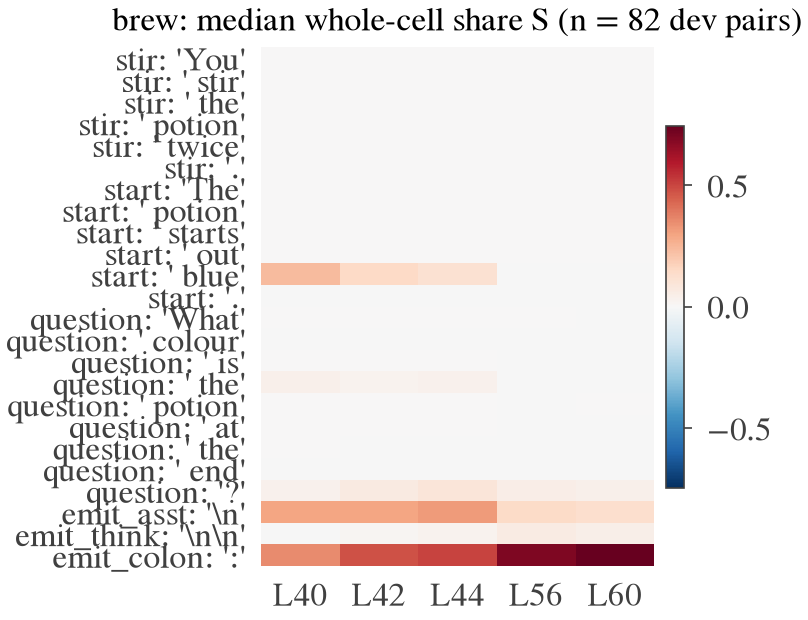
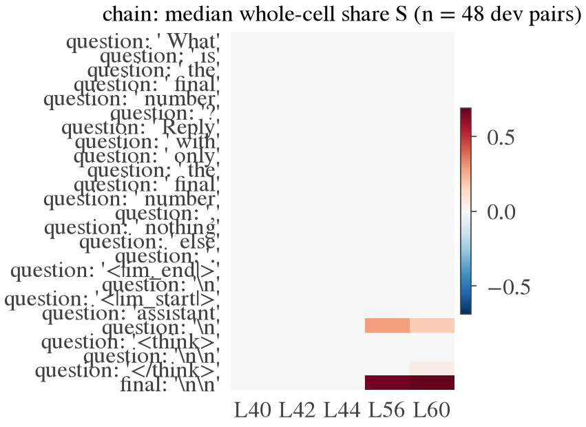

# 001 — Leverage profile and off-trajectory content

*Qwen3.6-27B · WorkspaceBench brew + chain · dev split only · design `docs/design_specs/001_leverage_profile.md` (v3 +
amendment A1) · 2026-10-02.*

## Scope

- **Model:** one model, Qwen3.6-27B.
- **Material:** two WorkspaceBench families, brew and chain; dev split only.
- **Layers:** five block outputs: 40, 42, 44, 56, 60. The controls add L0–L4.
- **Regime:** SEC (stock bf16 through block 39, true fp32 from block 40).
- **Readers:** no reader is used in §1–§7. §8 is a separate descriptive reader snapshot.
- **Wording:** "carries leverage" / "share S" means the natural pair difference at this cell, transplanted from the
  partner prompt, moves this answer by that fraction of the full gap G. It does not mean "the model uses x".

## Provenance

| Stage | run_id | git at manifest write |
|---|---|---|
| gate | 20261002T074329Z | 5d5d1a3, dirty |
| smoke | 20261002T080920Z | 5d5d1a3, dirty |
| run | 20261002T081118Z | 647dcb5, clean |
| probes | 20261002T092423Z | f445816, dirty |
| snapshot | 20261002T095116Z | 6b55a02, dirty |

- **gate, smoke:** "dirty" because the analysis/figures stages were uncommitted when the manifest was written. The gate
  and measurement code were committed.
- **snapshot:** the code that ran is the one committed in 6b55a02, which includes the render-loop fix; it ran
  after the run and probe outputs were hashed. "dirty" because the report was being edited.
- **probes:** the probe code is as committed at f445816. "dirty" because snapshot-summary code was uncommitted when the
  manifest was written.
- **raw outputs:** `outputs/001_leverage_profile/` (sha256 in `manifest_run.json`).
- **tables:** `results/001_leverage_profile/analysis/`; figures in `results/001_leverage_profile/figures/`.

---

## 1. Setup

**Pairs** (design §2):
- **Brew start pairs:** same rule table, different start colour; token-aligned, differing only at the start-colour
  token.
- **Chain start pairs:** same steps, different start number.
- **Brew colour substitutions:** an off-trajectory colour c is replaced everywhere in the table by a colour c′ absent
  from it. Path and answer stay the same; only colour tokens inside the table change.
- **Splits:** brew by table (50/50, stratified by z); chain by step-sequence group (10/10).

**Measurement:**
- For every gated dev pair and every read cell × layer, the partner's whole residual at that cell replaces the
  member's.
- Δm is the change in m = LSE log P(a′ spellings) − LSE log P(a spellings), with full-sequence teacher forcing over
  every token.
- S = Δm / G.
- The reverse direction is measured on a fixed 30% of pairs.

**Cells:**
- Brew: WSB's 24 pinned cells (stir ×6, start ×6, question ×9, and the newline after `assistant`, the `\n\n` after
  `</think>`, the `:` after `Answer`).
- Chain: the question span (" What" → final `\n\n`, 25 positions).

## 2. Gate (admission; every candidate, dev and test)

| Family | dev pairs passing | test pairs passing | Notes |
|---|---|---|---|
| Brew start pairs | **82 / 183** (33 of 48 tables) | 77 / 178 (35 of 49 tables) | 3 items have no valid partner at all |
| Chain start pairs | **48 / 53** (12 of 13 items; **9 of 10 step groups**) | 37 / 46 (7 of 10 groups) | 22 of the 48 dev pairs share z = 5: thin and clustered |
| Brew substitutions | **43 / 50** | — (dev only) | |

**Brew pass rate by member z (dev)** varies widely: green 4/24, gold 2/10, orange 0/2, teal 12/19, gray 11/20.

**Failures look like competence, not formatting.** The model splits its samples between the right colour and a
neighbour. Seed-20261003 examples:
- answer **teal**: greedy " brown", samples brown ×6, teal ×2, gold, Brown;
- answer **green**: 5/10, the rest brown ×3, plus "Orange" and "1. Star…".

Every decode is in `outputs/001_leverage_profile/gate/gate_prompts.jsonl` and in the qualitative file.

## 3. Engine checks and controls (exact)

| Check | Brew (107 pair runs) | Chain (62) |
|---|---|---|
| Embedding anchor reproduces the partner bitwise | 100% | 100% |
| Self-patch is bitwise identical to clean | 100% | 100% |
| Prefix before the first differing token is bitwise identical | 100% | 100% |
| Stir cells are bitwise no-ops (start pairs) | 100% | n/a |

**Start-token (or start-digit) patch at block outputs L0, L1, L2, L4:**
- median S = 1.00 in both families (IQR about 0.997–1.003);
- 100% of pairs ≥ 0.9.

Block 0 is a GatedDeltaNet layer, but in this setting it does not spread the start colour into later positions enough
to matter. Patching the start token's block-0 output alone transfers the whole effect.

**Noise floor (SEC):** |Δm| from 1e-4-relative perturbations at the last read cell, L42, on 20 pairs per family:
- upper stack: max 4e-4 nats (brew) and 5e-4 (chain); RMS 1.4e-5 · G and 1.1e-5 · G.
- the same perturbation in the bf16 lower stack (start token, L2): max 0.12–0.16 nats, RMS ≈ 0.004 · G.

Every negligible call at L ≥ 40 is about 4 orders of magnitude above the floor.

## 4. Where a single cell carries leverage — brew (82 pairs, 33 tables)

S is the median over pairs. The interval is the 95% cluster-t interval over table means (tables are the clusters).
Fractions are over pairs:
- "toward" = S ≥ 0.10;
- "negligible" = |S| < 0.05;
- "away" = S ≤ −0.10.

| Cell | L40 | L42 | L44 | L56 | L60 |
|---|---|---|---|---|---|
| `:` after `Answer` | 0.35 [0.26, 0.34] | 0.48 [0.40, 0.48] | **0.50 [0.42, 0.50]** | 0.70 [0.67, 0.73] | **0.74 [0.70, 0.76]** |
| newline after `assistant` | 0.29 | 0.29 | 0.32 | 0.14 | 0.13 |
| `\n\n` after `</think>` | 0.00 | 0.01 | 0.03 | 0.06 | 0.04 |
| start-colour token | **0.23 [0.21, 0.33]** | 0.15 | 0.12 [0.11, 0.19] | 0.00 | 0.00 |
| last question token `?` | 0.03 | 0.07 | 0.09 [0.06, 0.11] | 0.05 | 0.04 |
| every other start/question token, every stir token | 0.00 | 0.00 | 0.00 | 0.00 | 0.00 |

- **The `:` cell at L42–44 carries about half the gap in every pair:** 100% toward, 0% negligible, 0% away. Its share
  rises with depth to 0.74 by L60.
- **The start-colour token still carries about a quarter of the gap at L40.** It falls to 0 by L56. The colour is read
  from its own position well into the middle layers.
- **The newline after `assistant` carries about 0.3 at L40–44.** The `\n\n` after `</think>` carries almost nothing,
  although it sits between the two.
- **Spans** (whole region, all five layers jointly):

  | Span | Median S |
  |---|---|
  | emission (3 cells) | 0.92 |
  | start | 0.24 |
  | question | 0.17 |
  | start + question + emission | **1.00** |

  The whole effect is recovered by these regions; no other position is needed.
- **No cell moves the answer the wrong way:** "away" is 0% everywhere.
- **Reverse direction** (partner ← member, 30%) agrees with the forward direction: Pearson 0.84 over 375 cell-layer
  pairs; median |difference| 0.065.

**Within-position variation (diagnostic):** cells where at least 10% of pairs are toward and at least 10% are
negligible, with SD above 3× the noise:
- start token at L42;
- last question token at L42/44/56;
- question token #3 at L40;
- `\n\n` after `</think>` at L56/60.

The `:` and `assistant` cells at L40–44 show no such variation: whole-cell leverage there is uniform across pairs. So
whole-cell leverage alone cannot supply a used / not-used contrast at the emission cells. The content-level contrast
(§6–§7) has to.

**Damage flag** (pre-registered: an off-pair mass increase > 0.10 in > 20% of pairs means damage-dominated):

| Cell | Layers | Pairs flagged |
|---|---|---|
| `:` | L40–60 | 46–67% |
| start token | L40 | 61% |
| newline after `assistant` | L40 | 46% |

So these cells are **damage-dominated by the pre-registered rule**. But the extra probability is not spread at random.
Over the top-5 tokens at the `:` cell, L44:

| Destination | Mean probability |
|---|---|
| a | 0.36 |
| a′ | 0.27 |
| z | 0.048 |
| z′ | 0.043 |
| end-of-turn / format | 0.027 |
| other colours | 0.021 |

Most of the off-pair mass lands on the two pairs' **intermediate colours**. A half-transplanted state tends to answer
with an intermediate. The rule counts that as damage, which overstates harm here. Proposal for AMENDMENT_02: split
damage into "intermediate / colour answers" and "non-colour mass", and add top-1 retention.

## 5. Chain (48 pairs, 12 items, 9 step groups)

- **At L40–44 no single question-span cell carries the answer.**
  - Final `\n\n` cell: S ≈ 0.001 at each of L40, L42 and L44 (widest interval, L44: [−0.003, 0.010]); 96–100%
    negligible.
  - Every other question-span cell is about 0.
- **At L56–60 the final cell carries 0.66–0.69** ([0.54, 0.72] and [0.51, 0.74]), with the newline after `assistant`
  at 0.28 (L56).
- **Spans** across L40–60: the input digits carry 0.98, the question span 1.00. Taken with the per-cell zeros at
  L40–44, the answer is still read from the input digits at those layers and is assembled at the end of the prompt
  only after L44.
- **Reverse direction:** Pearson 0.97 over 70 pairs.

Limitation: only 9 independent step groups, and 22 of 48 pairs share z = 5. Chain stays a secondary pilot, as the
design allowed.

## 6. Off-trajectory substitution (43 items)

Bound (§3.3, provisional):
- |Δlog P(a)| < ε′ · median G = 0.05 × 9.59 = **0.48 nats**;
- total variation (TV) over the 12-colour answer distribution < **0.05**.

| Measure | Result |
|---|---|
| Behaviour (natural prompt): within bound | **39 / 43 (90.7%)**; median \|Δlog P(a)\| 0.017, median TV 0.019 |
| Transplant of the substituted state at the emission cells: within bound at every cell × layer | **41 / 43 (95.3%)**; per cell × layer 97.7–100% |
| Substituted key token at L0 (reference) | median \|Δlog P(a)\| 0.020 |
| Removed colour = T(a), the answer's successor (3 items) | behaviour 2/3 and transplant 2/3 within bound; c unrelated (40 items): 92.5% and 97.5% |

**All four items over the bound fail only TV, and narrowly** (0.053–0.096; |Δlog P(a)| ≤ 0.11 nats). Each one moves a
small tail mass from the removed colour to the inserted one.

Example, `0107` (green → black, answer gold):

| | gold | green | black |
|---|---|---|---|
| original | 0.55 | 0.04 | — |
| substituted | 0.62 | — | 0.05 |

(Next-token probabilities of the lower-case tokens; "—" = not in the top 5. On the 12-colour answer distribution, green
falls 0.057 → 0.001 and black rises 0.0004 → 0.062.)

So the answer is insensitive to the substitution, but its tail is not: the model's output distribution carries a
trace of which colours are in the table.

Caveat: the 90.7% behavioural figure sits just above the 90% line (Q12). That margin is fragile.

## 7. Decodability (probes; natural dev renders, folds grouped by table)

12-way balanced accuracy (chance ≈ 0.083); the Hewitt–Liang control task sits at 0.05–0.12:

| Target | `:` L40 | `:` L44 | `:` L60 | assistant-newline L42 | `</think>`-newline L42 |
|---|---|---|---|---|---|
| z (intermediate) | **0.77** | **0.75** | 0.68 | 0.81 | 0.81 |
| start | 0.81 | 0.74 | 0.53 | 0.77 | 0.85 |
| answer | **0.17** | **0.18** | **0.83** | 0.19 | 0.14 |

- **z and start are strongly decodable at every emission cell at L40–44** (BH-significant, selectivity 0.61–0.77).
- **The answer is barely decodable at L40–44:** balanced accuracy 0.14–0.26, and only 3 of the 9 cell × layer
  combinations pass the selectivity rule, all weakly (selectivity 0.11–0.16). It becomes strongly decodable at L56/60
  (0.83–0.89).
- So at the verbalizers' layers the emission cells hold the start and the intermediate but not yet the answer. That is
  the order expected of a two-step computation.

**Off-trajectory membership** ("is colour c in this table?"; 11 colours had support; pooled AUC):
- **0.57–0.63 at L40–56.** Above the permutation null (BH p ≤ 0.02 everywhere), but selectivity over the control task
  is < 0.10, so **not decodable by the pre-registered rule**.
- **0.76 at `:` L60 and 0.72 at `</think>` L60.** Selectivity 0.19 and 0.13: **decodable**.

**Cross-fitted directional test** (probe fitted without the item's table, applied to its original and substituted
renders):

| Layer | Removed colour's score falls | Inserted colour's score rises |
|---|---|---|
| L40–44 | 67–82% of items | 77–89% |
| L60 | 98% (`:`), 98% (`</think>`) | 98%, 94% |

Mean logit shifts at the `:` cell, L60: −1.90 and +2.14.

Probe power (from a synthetic check): with about 180 renders in 5120 dimensions, a single strong direction in isotropic
noise only reaches AUC about 0.68. The z/start/answer results show the probe works on strong signals. The weak
L40–56 membership AUCs may be a limit of the probe as much as of the representation.

## 8. Reader snapshot (descriptive; 10 dev tables; 32 min; run after the reader-free outputs were hashed)

**Protocol** (design §3.7 + A1):
- **Tables:** the first 10 dev tables with a gated start pair and a gated substitution.
- **Activations per table:** the member, its start partner, and the substituted render.
- **Cells:** the three emission cells.

| Reader | Layers | Samples |
|---|---|---|
| Lenses: J_NP (cosine and standard), J_CB, R_CB, logit lens | L20–60 every 4, plus L42 | top-10 tokens |
| Oracle Lens, WSB protocol | the same grid | 1 per cell |
| Oracle Lens, contract | L40 / L44 at `:` | 4 |
| NLA | L42, all three cells | 4, plus reconstruction (FVE) |

**Arms:**
- real: this cell's own activation;
- none: no activation, for the verbalizers;
- shuffled: the same cell from another snapshot table. Scored against this table's colours, this gives the chance rate
  of naming them.
- SEC: the same cell captured in the SEC regime.

Colour naming is by word match (English + Chinese colour characters), not a judge. Full readouts are in
`analysis/snapshot.json`; rates are in `analysis/snapshot_summary.json`.

**Bridge (stock vs SEC capture).**
- cosine ≥ 0.99985 at every layer;
- lens top-10 lists agree 99.4% on average (minimum 80%);
- Oracle/NLA naming rates match between the two arms to within sampling noise.

Reader outputs do not depend on the capture regime, so SEC assay results and stock-fed reader outputs can be set side
by side (the design's bridge condition holds).

**Who names what at the `:` cell (member activation; fraction of readouts naming the item's colour).**

| Reader (real arm) | z | start | answer | an off-path candidate | Same reader, shuffled arm (z / off-path) |
|---|---|---|---|---|---|
| Any lens, L20–48 | **0** | 0 | 0 | 0–0.1 (J_NP cosine L36: “Green” in 1 table) | 0 / 0 |
| Any lens, L52 | 0 | 0 | 0.4–0.9 | 0 | |
| Any lens, L56 | 0–0.1 | 0 | **1.0** | 0.1–0.2 | |
| Any lens, L60 | 0.2–0.7 | 0–0.1 | **1.0** | 0–0.5 | |
| Oracle, 1 sample, L20–44 | 0.2–0.7 | 0.2–0.4 | 0–0.2 | 0.3–0.5 | |
| Oracle, 1 sample, L52–60 | 0.5–0.6 | 0.1 | **1.0** | 0.3–0.5 | |
| Oracle, 4 samples, L40 | **0.53** | 0.35 | 0.28 | 0.55 | 0.38 / 0.60 |
| NLA L42 (`:` / `</think>` / assistant cells) | **0.43 / 0.60 / 0.55** | 0.03–0.30 | 0.15–0.23 | 0.30–0.45 | 0.20–0.25 / 0.30–0.63 |

- **The explained disagreement from the smoke test holds on all 10 tables.**
  - At L40–44 the probes decode z from the `:` cell (bal. acc. 0.75–0.77), and the cell carries about half the pair
    difference (§4).
  - The NLA names this table's z at about twice the shuffled rate.
  - No lens names any colour in its top 10; the J lenses show task-structure tokens instead ("second", "again",
    "next", "final"; 第二次 "second time", 再次 "again").
  - The lenses name the answer from L52 and z only at L60, where z is the model's runner-up output.
- **One lens colour at L20–48:** J_NP cosine at L36 lists “Green” for table 0015 (an off-path candidate there) and
  for table 0009's partner (its answer). The same capitalised token at the same lens and layer in two unrelated
  tables looks like a lens-level token, not table content (n = 2). At L40–44 no lens names a colour.
- **Off-path candidates are named about as often with a shuffled activation as with the real one** (Oracle 0.55 vs
  0.60; NLA 0.30–0.45 vs 0.30–0.63). The verbalizers' off-path mentions are not tied to this activation.
- **No reader tracks the substitution.**

| Reader, `:` cell | Removed colour c, original → substituted | Inserted colour c′, original → substituted |
|---|---|---|
| NLA L42 (real) | 0.12 → 0.10 | 0.28 → 0.15 |
| Oracle L40, 4 samples (real) | 0.28 → 0.30 | 0.42 → 0.45 |
| Oracle L44, 4 samples (real) | 0.30 → 0.35 | 0.25 → 0.30 |
| Lenses L56 / L60 | 0–0.2 → 0–0.1 | 0 → 0–0.1 |

The changes are within the shuffled-arm noise (n = 10 tables). The cross-fitted probe follows the same edit in 98% of
items at L60 (§7). Observation, n = 10: the table change is linearly decodable but no reader reports it.

- **NLA reconstruction does not identify the item.**

  | Explanations | FVE against this cell (median) |
  |---|---|
  | Own (real) | 0.49 |
  | Shuffled, from another table | 0.48 (0.50 against its own source) |
  | No activation | −0.35 |

  On these near-identical prompts, FVE reflects the shared brew template, not item-specific content.

**Qualitative example** (table 0009: gold → **red** → purple; substitution pink → blue; shuffled from table 0015):

| Reader | Output |
|---|---|
| J_NP cosine, `:` L40 | `kembali`, `다시`, `снова`, `послед`, `第二次`, `再次`, `Cycle`, `Sequence`, `AGAIN`, `novamente` ("again"/"second time" in five languages) |
| J_NP cosine, `:` L44 | `SECOND`, `AGAIN`, `FOLLOW`, `NEXT`, `второй`, `FINAL`, `END`, … |
| J_NP cosine, `:` L60 | `purple`, `Purple`, `紫色`, … `pink` |
| Oracle L40 (real, sample 1) | "- Blue (Explanation: Green → Red, then Red → Blue after two steps) - Red (or Blue …) - Blue, Red …" |
| Oracle L40 (no activation) | Korean company names (㈜) |
| NLA L42 (real, sample 1; FVE 0.55) | "…a chain-following puzzle with specific examples ("Input: **red** → output: red → next: green") … a color cycle lookup table (red→cyan, cyan→blue …) …" |
| NLA L42 (shuffled, sample 1; FVE 0.53) | "…a color transformation chain step … "orange -> yellow -> ?" …" |
| NLA L42 (no activation) | "Educational product review pattern … a knitting pattern book …" |

The NLA centres its story on **red**, the hidden step, and surrounds it with invented content (cyan, shell commands).
The Oracle names red and blue in invented chains.

Limitations: 10 tables; word matching, not a judge; one prompt template; 1–4 samples per reader and cell. Descriptive
only. No reader result here enters any decision.

## 9. Decision rules (design §6)

| Rule | Outcome |
|---|---|
| 1. Within-position variation (diagnostic) | Present at the start token, the last question token and the `</think>` newline; **absent at the `:` and assistant-newline cells at L40–44**, where every pair is "toward". Whole-cell leverage does not supply the contrast at the emission cells; content level does (rule 2) |
| 2. Brew supplies a not-needed class | **Yes, but only at L60.** Off-trajectory membership is decodable at `:` and `</think>` L60, and the substitution is behaviourally and transplant-negligible (90.7% / 95.3%). At L40–44, where the Oracle and NLA read, membership is not decodable by the rule, though the directional test follows the edit in most items. The RHUT fallback is not triggered |
| 3. Engine checks | **Pass** (every exact check, every pair) |
| 4. Power | **Pass** (82 brew, 48 chain dev pairs), but chain spans only 9 groups |
| 5. Threshold revision (τ, ε′, bound) | Not yet; proposal in §13 |

## 10. Predictions vs outcomes (priors from design §5)

| # | Prediction | Prior | Outcome |
|---|---|---|---|
| Q1 | Gate ≥ 40% of brew and chain candidates | 55% | **True** (brew 159/361 = 44%; chain 85/99 = 86%) |
| Q2 | Start-token L0 median S ≥ 0.5 | 60% | **True** (1.00) |
| Q3 | Start token L40–44 median \|S\| < ε′ | 70% | **False** (0.23 / 0.15 / 0.12) |
| Q4 | `:` median rises L40 < L42 < L44, L44 ≥ 0.3 | 65% | **True** (0.35 < 0.48 < 0.50) |
| Q5 | Every brew question cell negligible (TOST) at L40–44 | 45% | **False** (`?` at L42/44 and token #3 at L40) |
| Q6 | Within-position variation at ≥ 1 brew emission cell × layer | 50% | **True, only at `</think>` L56/60** |
| Q7 | Same for chain | 40% | **True** (one question cell, L60) |
| Q8 | z decodable at `:` L40, 42, 44 | 70% | **True** |
| Q9 | Off-trajectory membership decodable at ≥ 1 emission cell × layer | 55% | **True (L60 only)** |
| Q10 | Answer more decodable than z at `:` L44 | 65% | **False** (0.18 vs 0.75) |
| Q11 | Damage-dominated emission patches in < 10% of pairs | 75% | **False** (46–67% at `:`; see §4 on what the flag catches) |
| Q12 | Substitution behaviourally negligible in ≥ 90% | 70% | **True, narrowly** (90.7%) |
| Q13 | Transplants negligible in ≥ 90% at every layer | 75% | **True** (≥ 97.7% per cell × layer) |
| Q14 | `:` median at L56 and L60 > L44 | 70% | **True** (0.70, 0.74 > 0.50) |

## 11. Qualitative sample (seed 20261003; full record in `analysis/qualitative.json`)

Brew, the `:` cell transplanted at L44:

| Pair | Member → partner answer | G | Share S at `:`, L40 / 44 / 60 | Start-token S, L40 | Top-3 after the L44 patch |
|---|---|---|---|---|---|
| 0012__red | black → purple | 8.3 | 0.32 / 0.34 / 0.55 | 0.51 | black 0.26, purple 0.18, Black 0.08 |
| 0383__red | brown → orange | 6.1 | 0.45 / 0.59 / 0.76 | 0.41 | orange 0.56, brown 0.16, Orange 0.09 |
| 0009__black | purple → green | 9.0 | 0.40 / 0.51 / 0.69 | 0.19 | purple 0.32, green 0.20, Green 0.10 |
| 0172__teal | gray → white | 6.6 | 0.26 / 0.39 / 0.70 | 0.17 | gray 0.55, white 0.18, `<im_end>` 0.05 |
| 0075__orange | teal → white | 11.2 | 0.50 / 0.60 / 0.83 | 0.13 | white 0.49, teal 0.20, White 0.10 |
| 0312__blue | purple → brown | 12.6 | 0.37 / 0.56 / 0.69 | 0.35 | brown 0.52, purple 0.13, Brown 0.08 |
| 0140__brown | blue → gold | 9.3 | 0.30 / 0.38 / 0.74 | 0.19 | gold 0.22, brown 0.18, blue 0.14 |
| 0312__red | purple → gold | 14.6 | 0.54 / 0.65 / 0.79 | 0.23 | gold 0.43, Gold 0.14, brown 0.10 |

In 0140__brown (member gold → teal → blue; partner brown → black → gold), the second-ranked token after the patch is
**brown, the partner's start colour**. Off-pair mass usually goes to the intermediates (§4); here it goes to the
partner's start colour.

Chain:
- `0408__13` (2 → 1): final cell S 0.70 / 0.71 at L56 / L60, 0 at L40–44. After the L56 patch, "1" = 0.99.
- `0181__5` (11 → 7): final cell 0.40 / 0.48.
- `0013__5` (14 → 17): 0.33 / 0.27, with "1" = 1.00 as the first token. The digit after it carries the effect, which
  is why every answer token is scored.

## 12. Limitations

Each is stated next to its claim above; collected here:
- **Scope:** one model, dev split, two synthetic families, five layers. Chain has 9 independent groups.
- **Whole-cell shares measure the natural pair difference** (start, z, answer and everything downstream move together).
  They do not say which content is used.
- **The damage rule counts intermediate-colour answers as damage.**
- **Membership decodability at L40–56 is weak** and could be a probe-power limit.
- **The 90.7% behavioural substitution figure is near its threshold.**
- **SEC results are results under the SEC regime.** The stock-vs-SEC bridge for reader inputs is in §8.

## 13. Interpretation and next decision

Under these conditions:
- The answer cells at L40–44 carry a large, uniform share of the pair difference.
- They encode the start and the intermediate but not yet the answer.
- They also hold a small, measurable trace of off-trajectory table contents. That trace grows by L60, and it barely
  affects the answer.

Reader snapshot (descriptive, 10 tables):
- At L40–44 the verbalizers name the decodable intermediate above chance, while the lenses name no colour at all.
- No reader tracks the off-path table change that the probes decode.

The first explained disagreement is therefore "z is present and the pair difference is used at this cell; the NLA names
z, the J lenses do not", scoped to brew `:` at L40–44, 10 tables.

For W, this means:
- Brew offers a within-cell contrast at the emission cells: the pair difference with large leverage, against
  off-trajectory colours that are decodable (clearly at L60) and whose substitution barely moves the answer.
- The contrast is clean at L60.
- At the verbalizers' L40–44 it rests on the directional test more than on the pooled rule.

Proposed for AMENDMENT_02 (before any test-split label):
- keep τ = 0.10 and ε′ = 0.05 (the profile gives no reason to move them);
- adopt the §6 bound as frozen;
- split the damage readout as in §4;
- decide whether reader scoring of the not-needed class uses L60 (lenses) only, or also L40–44 via the directional
  criterion. This last one is the PI's decision.

## 14. Breakages and silly mistakes (all fixed; logged in CLAUDE.md)

- **Commit 79f835a's message** describes design v3, but its edit script had failed; v3 landed in e3666e1.
- **The brew split** rounded odd strata at random (51/49). Caught by a test before use.
- **The noise-floor helper** drew different directions across the forwards of one perturbation. Caught in review
  before running.
- **The snapshot's render dictionary** was written without its loop: UnboundLocalError before any reader ran.
- **A concurrent session** pushed b71d1df (park guard, the T(a) tag) while 001 ran.
- **Rounding slips in this report**, found while generating the results page from the same JSON (fixed here): `:` L60
  was written 0.75 [0.71, 0.76] (data 0.745 [0.705, 0.764] → 0.74 [0.70, 0.76]; also in §4 text and Q14);
  `</think>` L42 0.02 (0.0145 → 0.01); start-token L40 interval [0.22, 0.33] (0.215 → [0.21, 0.33]); answer probe
  at `</think>` L42 0.15 (0.1447 → 0.14; §7 range now 0.14–0.26). No conclusion changes. The chain L40–44 interval
  was L44's, unlabelled; now labelled. The page now draws every number from the JSON with round-half-up.
  The §8 row "Any lens, L20–48" said 0 for off-path candidates; it is 0–0.1 (one J_NP cosine readout at L36).
  - The run finished on 647dcb5 without the tag; the analysis back-fills it from the bank (f445816).
  - The push from this session was rejected and rebased, not forced.
